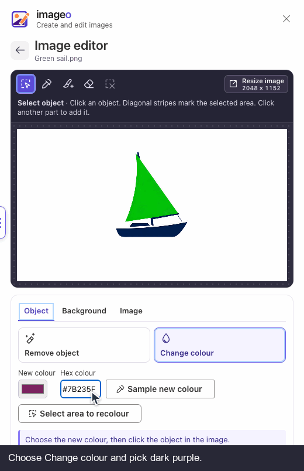
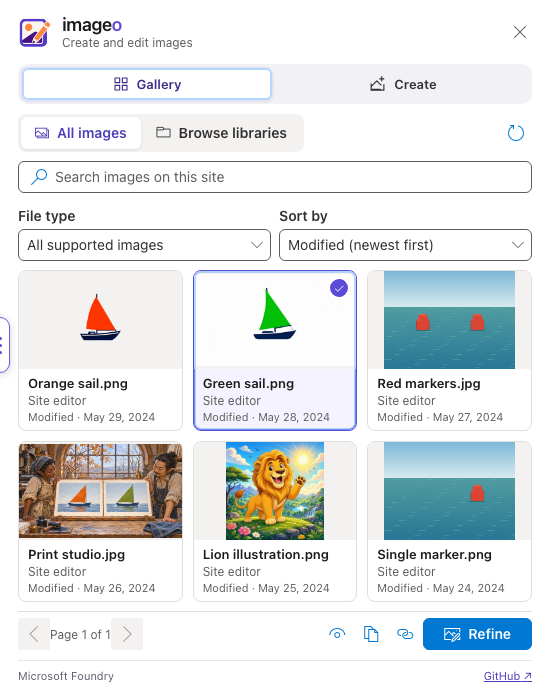
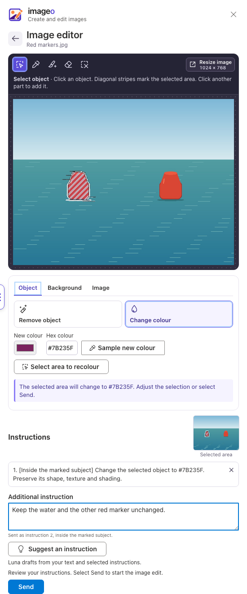
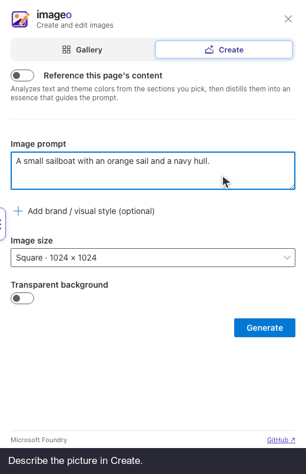
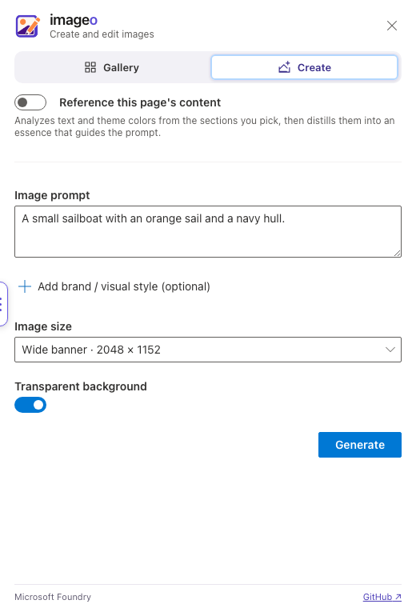
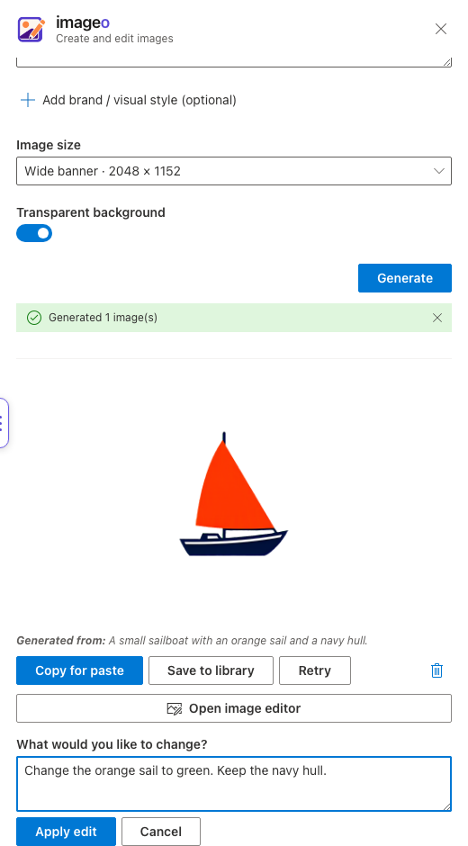
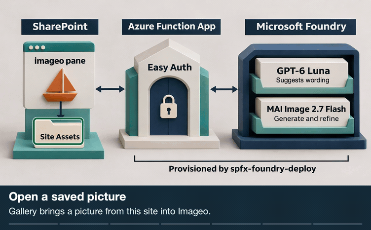

#  imageo

Imageo is a simple image generator and editor for SharePoint, powered by **MAI Image 2.7 Flash**. Open **Imageo** on the page you’re writing and choose where to start.

- **Create a picture.** Describe what you have in mind, or use text from your page as a starting point. Make a square illustration or a wide banner, with a transparent background if you like.
- **Edit a picture.** Open one you just generated, or pick one from your site’s **Gallery**. Turn an orange sail green, remove an unwanted object, or replace the background. You can also crop or resize the picture.

Compare your edit with the original, then save a copy to use on your page.

[Follow the sailboat example on the PuntoBello blog](https://www.puntobello.ch/en/nello/imageo_mai_image_27_flash/) · [Set up Imageo on your site](#quick-start)

<picture>
  <source media="(prefers-reduced-motion: reduce)" srcset="./assets/imageo-editor-demo-poster.png">
  
</picture>

*Recorded with Imageo 1.4.1.5, using a sample gallery. The pane replays real model responses. Cropping, resizing and simple background changes run in the browser.*

## Watch one task

| Task | What the recording shows | Open |
| --- | --- | --- |
| Find a picture on the site | Open the gallery and select a picture to edit. | [GIF](./assets/imageo-gallery-demo.gif) · [Still](./assets/imageo-gallery-demo-poster.png) |
| Use text from the page | Pick the sailing story and see the prompt Luna suggests. | [GIF](./assets/imageo-page-prompt-demo.gif) · [Still](./assets/imageo-page-prompt-demo-poster.png) |
| Generate a banner | Choose a wide size and a transparent background. | [GIF](./assets/imageo-demo.gif) · [Still](./assets/imageo-demo-poster.png) |
| Try the same prompt again | Retry keeps the first banner’s settings, even after the Create controls change. | [GIF](./assets/imageo-retry-demo.gif) · [Still](./assets/imageo-retry-demo-poster.png) |
| Refine a new picture | Keep the boat and ask for a green sail. | [GIF](./assets/imageo-quick-refine-demo.gif) · [Still](./assets/imageo-quick-refine-demo-poster.png) |
| Mark the part to change | Select an area, adjust the brush size and tidy the edges before editing. | [GIF](./assets/imageo-selection-demo.gif) · [Still](./assets/imageo-selection-demo-poster.png) |
| Change one colour | Mark the green sail and turn it dark purple. | [GIF](./assets/imageo-editor-demo.gif) · [Still](./assets/imageo-editor-demo-poster.png) |
| Get help finding the words | Ask Luna for wording, review it, then send it to MAI. | [GIF](./assets/imageo-luna-demo.gif) · [Still](./assets/imageo-luna-demo-poster.png) |
| Remove one object | Click the left red marker. Watch water fill the gap. | [GIF](./assets/imageo-remove-demo.gif) · [Still](./assets/imageo-remove-demo-poster.png) |
| Make a cutout | Keep the subject and remove the background. | [GIF](./assets/imageo-transparent-demo.gif) · [Still](./assets/imageo-transparent-demo-poster.png) |
| Use a solid background | Choose a single colour behind the subject. | [GIF](./assets/imageo-solid-demo.gif) · [Still](./assets/imageo-solid-demo-poster.png) |
| Replace the scene | Keep the red marker and put a mountain lake behind it. | [GIF](./assets/imageo-scene-demo.gif) · [Still](./assets/imageo-scene-demo-poster.png) |
| Crop the picture | Choose which part of the picture fits inside a square. | [GIF](./assets/imageo-crop-demo.gif) · [Still](./assets/imageo-crop-demo-poster.png) |
| Resize a copy | Keep the proportions while changing the pixel dimensions. | [GIF](./assets/imageo-resize-demo.gif) · [Still](./assets/imageo-resize-demo-poster.png) |

## Three things to try

| What you need for the page | What to do in Imageo |
| --- | --- |
| A regatta banner in the club colours | Generate a wide banner. Save the first boat, then use **Refine** to change its sail. Compare the two versions on the page background. |
| A cleaner event illustration | Upload the [picture with two red markers](./tests/fixtures/regatta-buoys.png) to a library, then open it in **Gallery**. Choose **Remove object** and click the left marker. [See the original, the area marked and the result](./assets/imageo-object-removal.png). |
| A product photo for a training page | Open a photo of a spare part and mark the part. Apply **Make background transparent** in the browser. Save a PNG copy and use the same cutout on light and dark SharePoint sections. |

Run `npm test` from the repository root after installing the backend and SPFx dependencies. The [test and showcase plan](./tests/imageo-test-plan.md) covers setup, expected results for each demo, and the checks that still need a live SharePoint run.

## Edit an existing picture

Open **Gallery** to see PNG and JPEG files from this site's document libraries.
Use **File type** to show all supported images, PNG files, or JPEG files (`.jpg` and `.jpeg`).
Search by filename, title, or creator. Sort by date created, date modified,
or creator. **Browse libraries** lets you open a specific folder with the same file type filter.
The pane fits whole rows of thumbnails to the available space. Use the arrows
below the thumbnails to move between pages.



Select a picture and choose **Refine**. For a picture you just generated in
**Create**, choose **Open image editor** under the preview.
Above the picture, the toolbar names the active selection tool and explains how to use it.

To give a sail the same blue as the water, choose **Object → Change colour**.

1. Choose **Sample new colour** and click the water. The numbered instruction now shows the sampled hex colour. You can also enter a hex value or use the colour picker.
2. Click the sail. Diagonal stripes and a pulsing outline mark the selected area. With reduced motion enabled, the outline stays still. Check the thumbnail beside **Instructions**. For a touch-up, choose **Add brush** or **Erase brush**, adjust **Brush size**, and paint over the area you want to add or remove from the selection.
3. Review the instruction. You can change its settings, remove it with **×**, or type a detail such as “Keep the stitching visible” in **Additional instruction**. Choose **Send** to start the edit.
4. Choose **Compare with original** to review the result. **Save as copy** writes a new PNG to Site Assets.

**What does Send use?** For a selected-object edit, the Azure Function sends MAI the full source PNG, a second PNG with the selection marked in magenta, and the numbered instructions. The browser combines the returned edit with the original pixels outside the selection. For a whole-image request, enter your wording in **Additional instruction** and send it on its own.

**Where does Luna help?** Type what you want in your own words. For example, ask to keep the ropes as they are and make the sail easier to see from a distance. Choose **Suggest an instruction**. Luna receives your words and any model instructions already in the list. Turn on **Include page summary** to share a summary of the page sections you picked. Review Luna’s wording in **Additional instruction**. You can change it or clear it. When you’re ready, choose **Send**. In the recording, MAI returns a darker green sail.



In the marker test, MAI filled the gap with water. Every pixel in the right half of the saved copy, including the second red marker, matched the original.

For a cutout, select the subject to keep, open **Background** and choose **Make background transparent**. For a flat colour, choose **Solid background** and pick a colour. Choose **Apply locally** to see either change. You can also crop a square or wide banner under **Image → Crop** and apply the crop in the browser.

For a new setting, choose **Replace scene**, describe the background and select **Send**. In the recording, MAI supplies a mountain lake and Imageo keeps the selected red marker. Use **Compare with original** to check the edit. **Save as copy** writes a new PNG to `SiteAssets/AIImages`.

To resize the saved picture, choose **Resize image** above the canvas. Enter the width
or height in pixels. **Keep proportions** updates the other dimension. Choose **Apply size**,
then **Apply locally** and **Save as copy**. If you also crop the picture, Imageo crops
first and resizes the result to the dimensions shown under **Browser actions**.

For an existing installation, use Imageo Function `0.5.2` with SharePoint
package `1.4.1.5`. This Function version provides the editor's instruction suggestion route.

## Generate a banner and refine it

<picture>
  <source media="(prefers-reduced-motion: reduce)" srcset="./assets/imageo-demo-poster.png">
  
</picture>

Open **Create** and choose **Image size** above **Generate**. Choose a
1024×1024 square (default), a 2048×2048 square, or a 2048×1152 wide banner.
For a cutout on a colored page section, turn on **Transparent background**.
Select **Generate** to create one PNG with those settings.



On a generated image, **Retry** creates a fresh image with the original prompt,
size and background setting. To edit the image you already have, choose
**Refine**, describe the change and select **Apply edit**. A refined PNG can
come back opaque. Save the transparent original to Site Assets first if you
need both versions.



If Foundry rejects a request, expand **Service response** under the error to
see its HTTP status and any available error code, screening stage, category,
or request ID. Starting another image request clears the previous run’s notice.

<details>
<summary>Example service response for a blocked image</summary>

```json
{
  "httpStatus": 400,
  "providerCode": "content_safety_violation",
  "stage": "output",
  "category": "disallowed",
  "message": "Output content violated safety policies. Violation categories: disallowed."
}
```

</details>

## Architecture

<picture>
  <source media="(prefers-reduced-motion: reduce)" srcset="./assets/imageo-architecture.webp">
  
</picture>

[View the static architecture diagram](./assets/imageo-architecture.webp)

- **`backend/`** — Azure Functions v4 (Node 22, TypeScript). The image routes
  `/api/generate-image` and `/api/refine-image` use MAI-Image-2.7-Flash.
  GPT-6 Luna handles page analysis at `/api/analyze-page` and `/api/distill-scope`.
  The editor sends text to `/api/suggest-edit-instruction` when the author asks Luna for an instruction.
- **`spfx/`** — SPFx 1.24.1 (Heft toolchain) Application Customizer. A floating
  launcher opens a Fluent UI panel. It uses a visible Bottom or Top placeholder supplied by SharePoint. Page content is
  read via SharePoint REST; generated images are written to the Site Assets
  library via PnPjs. The page itself is never modified.
- **`spfx/deploy.config.json`** — deployment is handled by the shared
  [`spfx-foundry-deploy`](https://github.com/ferrarirosso/spfx-foundry-deploy)
  (multi-model profile: the two model deployments + an Easy-Auth-protected Function
  proxy). Idempotent; state is written to `.deploy-output.json` (gitignored).

## What gets provisioned

`spfx-foundry-deploy` provisions the full footprint in one resource group — the
Foundry account, the Function proxy, Easy Auth, managed identity + roles, storage,
App Insights, and hardening (see its
[README](https://github.com/ferrarirosso/spfx-foundry-deploy)). imageo's only
addition over a single-model deploy is its `spfx/deploy.config.json`, which declares
two Global Standard deployments in Sweden Central.

| Role | Model | Model version | Requested capacity |
| --- | --- | --- | ---: |
| Image generation and editing | `MAI-Image-2.7-Flash` | `2026-11-02` | 2 |
| Page analysis and edit wording | `gpt-6-luna` | `2026-09-22` | 50 |

The public configuration uses example deployment names. The npm deployment commands
read `spfx/deploy.config.local.json`. Git ignores this file. For an existing
environment, set your resource name prefix and deployment names in the local copy.

The Function sends the image deployment name in the `model` field of its MAI
generations request. The panel shows the deployment name with the generated image.
To display a model name such as `MAI-Image-2.7-Flash`, set the optional Function
app setting `IMAGE_MODEL_LABEL`. Update or remove the label whenever you switch
the image deployment, including during rollback.

## Quick start

```bash
# From the repo root, create the local config if needed. Adjust its values for your deployment.
cp -n spfx/deploy.config.json spfx/deploy.config.local.json

# 1. Provision Azure (interactive; discovers tenant/subscription via az).
#    Creates both model deployments + the Easy-Auth-protected Function proxy
#    and writes .deploy-output.json at the repo root.
npm run deploy

# 2. Build the package — the webpack patch reads .deploy-output.json and bakes
#    the backend URL + API resource into the bundle.
cd spfx && npm install && npm run build   # -> sharepoint/solution/imageo.sppkg
```

The deploy, dry-run and teardown scripts use the same
[pinned deployer revision](https://github.com/ferrarirosso/spfx-foundry-deploy/tree/05f52b0ae6da1b10385a1e879da6eedc589dedc5).

Upload `imageo.sppkg` to the App Catalog, approve the API permission request
(SharePoint admin → API access), and add the extension. No property-pane step —
the backend coordinates are compiled in (see *Configuration*).

## Security posture

The proxy's auth and hardening come from the deployer —
[`spfx-foundry-deploy`](https://github.com/ferrarirosso/spfx-foundry-deploy)
sets up Easy Auth (Entra-required), managed identity to Foundry (no key in
deployed config), tenant-scoped CORS, and platform hardening (HTTPS-only,
TLS 1.2, FTP off, App Insights). The auth chain:
`AadTokenProvider.getToken(backendApiResource)` → `Authorization: Bearer …` →
Easy Auth (audience-pinned) → Function code → managed identity → Foundry.
No function key in the browser bundle.

imageo-specific: hex / RGB color codes in user-typed fields are translated to
color names before reaching the image model (so they don't render as literal
text), and per-section + aggregate request-size caps bound each analysis call.

## Prerequisites

- Node 22.14+ in the 22.x line, Node 24.x, or Node 26.x for the SPFx build
- Azure CLI (`az`), signed in to the target tenant
- Azure Functions Core Tools v4 (`func`)
- Quota for MAI-Image-2.7-Flash and GPT-6 Luna in the chosen region
  (defaults to Sweden Central)

## Configuration

The deployer discovers tenant + subscription via `az` and prompts for the rest;
no identifiers are hardcoded. It writes the role-named app settings on the Function
App (`AZURE_OPENAI_DEPLOYMENT_IMAGE` / `_ANALYZE`, per-role API versions, shared
endpoint, auth flags) and records the front-end coordinates in `.deploy-output.json`.

**How the backend URL reaches the extension.** An Application Customizer has no
property pane, so the backend coordinates are compiled into the bundle at build
time. The chain is:

1. **Deploy** writes `.deploy-output.json` (`backendUrl`, `backendApiResource`).
2. **`npm run build`** runs the Heft webpack patch (`config/webpack-patch/env-inject.js`),
   which reads `.deploy-output.json` and, via webpack `DefinePlugin`, replaces the
   `process.env.SPFX_IMAGEO_*` references with string literals.
3. At runtime `utils/env.ts` derives the API routes from `backendUrl` and uses
   `backendApiResource` as the AAD token resource (customizer → Fab → Panel →
   `BackendClient`).

Because the values are compiled in, each tenant builds its own `.sppkg` with its
own backend URL — expected for a single-tenant solution. `.deploy-output.json` and
the built `.sppkg` are gitignored. `IMAGEO_DEBUG=true` enables verbose backend
logging (off by default).

### Preparing a public sample

Review the staged diff after running the deployer. It writes the tenant's backend
API display name into `webApiPermissionRequests` in `spfx/config/package-solution.json`.
Keep that entry in the tenant build and the empty list in public source. Use
example deployment names in public commands and logs. For screenshots and GIFs,
use fictional page content and neutral artwork, then watch the entire recording
for visible accounts, site addresses, branding, and previously generated images.

## Working within SharePoint's model

imageo stays inside SharePoint's supported extensibility guardrails. It **never
modifies the page** — no DOM manipulation, no writes to a page's internal
`CanvasContent1` canvas. The only thing it persists to SharePoint is the generated
image, written to the **Site Assets** library (`SiteAssets/AIImages`), a first-class
SharePoint store. The publisher then places it with the standard Image web part (or
pastes it from the clipboard). Staying out of the page's canvas avoids the editor's
client-side React state and co-authoring locks entirely.

## Teardown

```bash
npm run teardown
```

Deletes the resource group and the Entra app registration. Cognitive Services
soft-delete lasts 48 h; the purge command is printed.

## License

MIT — see [LICENSE](./LICENSE).
